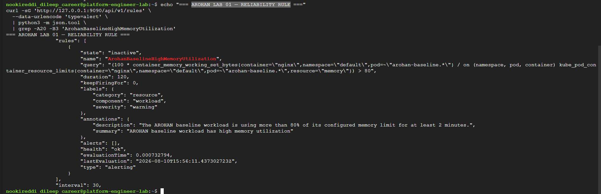

# PROJECT AROHAN AI (आरोहण, "ascent")

### A hands-on journey from enterprise Linux operations to AI infrastructure architecture

> **Build it. Break it. Measure it. Document it. Only then automate it.**

AROHAN AI is my long-term, hands-on engineering initiative. It covers how AI workloads are **scheduled, served, observed and kept reliable** on Kubernetes/OpenShift and GPU infrastructure, built as labs with failure injection and evidence rather than as reading notes.

The long-term direction is **governed autonomous operations**: AI-assisted diagnosis where *policy* decides what may be executed and *verification* proves it worked. That is the destination, not the current state. The table below shows exactly what exists today.

---

## Proof so far

**[Lab 01](labs/01-workload-reliability/README.md) ✅:** on a K3s cluster with Prometheus and kube-state-metrics, I joined live container memory with the declared Kubernetes limit in PromQL, alerted on sustained use above 80%, injected memory pressure (the alert went pending → firing at **86.35%** of the limit) and verified it returned to inactive after recovery. The rule is promtool-validated.



## What's actually here (status)

| Area | Item | Status |
|---|---|---|
| **Lab 01** | [Workload reliability foundation](labs/01-workload-reliability/README.md): K3s workload, Prometheus, reliability SLI + alert, controlled failure injection, alert lifecycle and recovery validation | ✅ **Done, with evidence** |
| **Lab 02** | [AI inference reliability](labs/02-ai-inference-reliability/README.md): an LLM (Ollama) on Kubernetes with quotas, probes, benchmarks, failure drills and RCAs | 🟡 Planned, runbook written (paused) |
| **Lab 03** | [GPU scheduling](labs/03-gpu-scheduling/README.md): filter/score, taints vs affinity, GPU fragmentation + bin-packing, gang deadlock, NVIDIA KAI Scheduler (kind + fake GPUs) | 🟡 Planned, runbook written (paused) |
| Notes | [Linux internals, the foundation under every platform](engineering/linux-internals/README.md): processes, memory/OOM, cgroups and namespaces, tracing, systemd, networking, production RCAs | ✅ Written |
| Notes | [OpenShift vs Kubernetes architecture](engineering/platform/OPENSHIFT_VS_KUBERNETES.md): layer-by-layer comparison, interview Q&As, and what changes for GPU and inference workloads | ✅ Written |
| Notes | [Kubernetes scheduling, from kube-scheduler to GPU gangs](engineering/gpu-scheduling/KUBERNETES_SCHEDULING_DEEP_DIVE.md) | ✅ Written |
| Notes | [AI inference on Kubernetes: lifecycle and latency](engineering/ai-inference/INFERENCE_ON_KUBERNETES.md) | ✅ Written |
| Notes | [AI-infrastructure notes](engineering/notes/README.md): one topic a week from a 40-topic curriculum, GPU fundamentals to reference architectures | 🟢 Weekly, first note due 21 Nov 2026 |
| Module | [Workload management mastery](engineering/workload-management/README.md): K8s / OpenShift / HPC / AI workload management from the infra layer up. Six-layer plan, lab checklists, drill library, topic notes twice a week | 🟢 Ongoing, twice a week |
| Module | [HPC & AI infrastructure mastery](engineering/hpc-ai-infrastructure/README.md): hands-on track for Tier 3 HPC & AI Factory operations. Slurm, Base Command Manager, InfiniBand/RDMA, GPU stack (DCGM, MIG, NCCL), GPUs on Kubernetes/OpenShift, monitoring and automation | 🟡 Planned, starts after OpenShift training (mid-2027) |
| Notes | [NVIDIA AI infrastructure foundations](engineering/NVIDIA/README.md) (prep for the NCA-AIIO certification, which I hold) | ✅ Written |
| Standards | [Engineering principles](standards/ENGINEERING_PRINCIPLES.md) · [standards & quality gates](standards/README.md) · [charter](CHARTER.md) | ✅ In use |
| Next | AI-assisted RCA, policy-guarded remediation, GPU telemetry (DCGM), GPU Operator, FinOps | ⚪ Future |

Status icons follow the [status model](standards/README.md#status-model): ✅ completed · 🔵 implemented, not yet validated · 🟢 in progress / ongoing · 🟡 planned · ⚪ future.

**Honest constraints:** labs run on a CPU-only GCP K3s cluster and on `kind` with simulated GPUs. No paid GPU hardware is used. Where a lab needs real GPUs, the README says so.

**Companion repos:** hands-on Kubernetes in [kubernetes-labs](https://github.com/NookireddiDileep/kubernetes-labs), OpenShift in [openshift-lab-records](https://github.com/NookireddiDileep/openshift-lab-records), and automation in [infra-automation-lab](https://github.com/NookireddiDileep/infra-automation-lab). See [related repositories](#related-repositories).

---

## The journey

The five stages from the [roadmap](ROADMAP.md#1-the-five-stages):

1. **Platform Engineering**: Kubernetes, OpenShift, GitOps, observability
2. **AI Infrastructure**: GPU scheduling, model serving, inference
3. **AI Operations**: telemetry, SLOs, RCA, FinOps
4. **Autonomous Operations (guarded)**: policy-checked remediation, verified after every action
5. **Autonomous AI Factory**: end-to-end GPU platform operations

**You are here:** Stage 1. Hands-on time is on OpenShift platform depth for now; AROHAN grows through regular theory notes, and Labs 02–03 resume after that.

Every capability follows the [lab lifecycle](standards/README.md#lab-lifecycle-and-maturity), and nothing is marked done without evidence in the lab's `evidence/` folder.

The target control loop, built step by step across labs:

**Observe → Detect → Diagnose → Decide → Guardrail → Remediate → Verify → Explain (RCA) → Notify → Audit**

> AI reasons about the situation. Policy decides what AI is allowed to do. Verification decides whether it worked.

More detail: [ROADMAP.md](ROADMAP.md) (stages, how autonomy is earned, planned sequence) · [CHANGELOG.md](CHANGELOG.md) (what has actually been implemented).

---

## Domains covered over time

| Domain | Topics |
|---|---|
| Platform | Linux, HPC, networking, storage, Kubernetes, OpenShift, containers, Helm, Ansible, GitOps/Argo CD |
| AI infrastructure | GPU scheduling, MIG/time-slicing, KAI/Kueue/Volcano, model serving, inference |
| Observability & SRE | Prometheus, Grafana, OpenTelemetry, SLI/SLO, error budgets, incident response |
| Security | RBAC, least privilege, NetworkPolicy, pod security / SCC, multi-tenancy, AI-agent permissions |
| FinOps | GPU utilization and idle time, cost per workload / request / token |

---

## Repository layout

```
project-arohan-ai/
├── labs/          hands-on labs: README runbook, manifests, scripts, evidence/
├── engineering/   deep-dive notes (Linux internals, OpenShift vs Kubernetes, scheduling, inference, NVIDIA foundations, workload-management and HPC & AI infrastructure mastery modules)
├── standards/     engineering standards and principles
├── CHARTER.md · ROADMAP.md · CHANGELOG.md
```

---

## Related repositories

Part of one hands-on platform-engineering portfolio. Start at my [GitHub profile](https://github.com/NookireddiDileep) for the overview.

| Repo | What's there |
|---|---|
| [kubernetes-labs](https://github.com/NookireddiDileep/kubernetes-labs) | Upstream Kubernetes on a K3s cluster I built myself: 13 labs, 9 break-and-fix scenarios, timed incident drills |
| [openshift-lab-records](https://github.com/NookireddiDileep/openshift-lab-records) | OpenShift 4.x on multi-node clusters: Jira-style stories, RCAs, break-fix runbooks, `oc` command bank, OpenShift vs Kubernetes guide |
| [infra-automation-lab](https://github.com/NookireddiDileep/infra-automation-lab) | One real ops scenario a day, solved in Bash, Ansible, Python and Go against the same golden tests |

---

## About

Built by **Nookireddi Dileep**, a senior Linux/infrastructure engineer (RHEL, HPC, private cloud) growing into Kubernetes/OpenShift platform engineering and AI infrastructure architecture. Some notes and lab designs are AI-assisted. Lab results and evidence come from my own runs.
