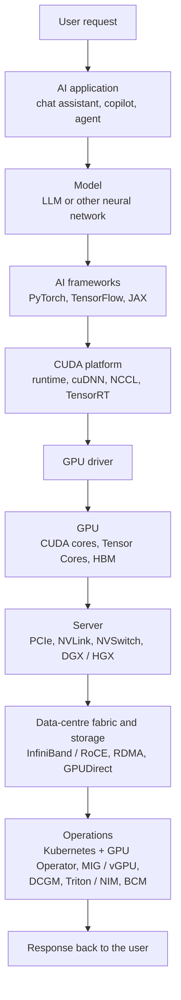

# NCA-AIIO — The NVIDIA AI Ecosystem in One Map

> **Project AROHAN AI · Engineering notes · NVIDIA track**
> A consolidated, revision-ready reference for the **NVIDIA-Certified Associate: AI Infrastructure and Operations (NCA-AIIO)**: how every exam topic connects end to end, the comparisons that exams and interviews test, corrections to the first-pass notes, and what to learn after the certification.
>
> The per-module first-pass notes stay where they are ([Module 01](Foundations/Module-01-Introduction-to-AI/README.md) · [Module 02](Foundations/Module-02-AI-Infrastructure/MY_NOTES.md) · [Module 03](Foundations/Module-03-AI-Operations/MY_NOTES.md)); this page links them into one picture instead of repeating them.

> **The one-line answer:** a user's request travels through an AI application and model, down through frameworks and CUDA to the GPU, across the server and data-centre fabric, and is run, shared, monitored and served by the operations layer — the exam tests whether you can see that whole chain, not just each box.

---

## 1. The exam blueprint

| Domain | Weight | Topics | First-pass notes |
|---|---|---|---|
| Essential AI knowledge | 38% | AI → ML → DL → generative AI and LLMs, training vs inference, CPU vs GPU, the NVIDIA software stack | [Module 01](Foundations/Module-01-Introduction-to-AI/README.md) |
| AI infrastructure | 40% | GPU architecture, CUDA and Tensor Cores, HBM, PCIe, NVLink and NVSwitch, DGX and HGX, InfiniBand, RDMA, RoCE, GPUDirect | [Module 02](Foundations/Module-02-AI-Infrastructure/MY_NOTES.md) |
| AI operations | 22% | Kubernetes, NVIDIA GPU Operator, MIG and vGPU, `nvidia-smi`, DCGM, Triton, NIM, Base Command Manager | [Module 03](Foundations/Module-03-AI-Operations/MY_NOTES.md) |

Passed — [verified Credly badge](https://www.credly.com/badges/bdcee063-5fa6-4907-b7b2-99d789e2de33).

Weights from the [official certification page](https://www.nvidia.com/en-us/learn/certification/ai-infrastructure-operations-associate). The certification is valid for two years; recertification is by retaking the exam.

---

## 2. The end-to-end chain

| Layer | What it is | NVIDIA components | What an operator cares about | Deeper in AROHAN |
|---|---|---|---|---|
| Application and model | The AI service and the trained network behind it | NIM-packaged models, NeMo (building models) | Latency, throughput, cost per request | [AI inference on Kubernetes](../ai-inference/INFERENCE_ON_KUBERNETES.md) |
| Frameworks and libraries | Code that defines and runs models | CUDA, cuDNN, NCCL, TensorRT | Version compatibility with the driver | [Lab 04 Ex 2, 6](../../labs/04-gpu-infra-hands-on/README.md) |
| Driver and GPU | Kernel module + the accelerator | GPU driver, CUDA cores, Tensor Cores, HBM | Driver ↔ kernel lifecycle, health, Xid errors | [Lab 04 Ex 3–5](../../labs/04-gpu-infra-hands-on/README.md) |
| Server | How GPUs are wired inside a node | PCIe, NVLink, NVSwitch, DGX, HGX | Topology, NUMA, bandwidth | [Lab 04 Ex 7](../../labs/04-gpu-infra-hands-on/README.md), [Lab 05 Ex 11](../../labs/05-gpu-cluster-operations/README.md) |
| Fabric and storage | How nodes and data connect | InfiniBand, RoCE, RDMA, GPUDirect RDMA / Storage | Multi-node bandwidth, checkpoint I/O | [Lab 05 Ex 6, 7, 10](../../labs/05-gpu-cluster-operations/README.md) |
| Operations | Run, share, monitor, serve, manage | GPU Operator, MIG, vGPU, `nvidia-smi`, DCGM, Triton, NIM, BCM | Scheduling, isolation, telemetry, lifecycle | [Orchestration overview](../gpu-scheduling/GPU_CLUSTER_ORCHESTRATION_OVERVIEW.md) |

---

## 3. Comparisons that exams and interviews test

### Interconnects: inside a server vs between servers

| | Connects | Scope | Typical use |
|---|---|---|---|
| PCIe | CPU ↔ GPU, GPU ↔ NIC/NVMe | Inside one server | General I/O; GPU-to-GPU only on systems without NVLink |
| NVLink | GPU ↔ GPU directly | Inside one server (or one NVLink domain) | Much higher GPU-to-GPU bandwidth than PCIe |
| NVSwitch | Many GPUs through a switch fabric | All GPUs in a DGX/HGX board, or a larger NVLink domain | Every GPU talks to every other at full NVLink speed |
| InfiniBand | Server ↔ server | Data-centre fabric | Lossless, low-latency RDMA networking for multi-node training |
| RoCE | Server ↔ server over Ethernet | Data-centre fabric | RDMA on Ethernet; needs a lossless-configured network |

### Sharing one GPU

| | How it works | Isolation | Where |
|---|---|---|---|
| MIG | Hardware partitions with dedicated memory and compute | Strong (hardware) | Data-centre GPUs that support it (e.g. A100, H100 class) — not every GPU |
| vGPU | GPU virtualised for multiple VMs through a hypervisor | Per-VM | Virtualised environments; licensed NVIDIA vGPU software |
| Time-slicing | Containers take turns on the whole GPU | None for memory or faults | Kubernetes device plugin config; dev/test |
| MPS | Processes share the GPU concurrently | Limited | Many small CUDA processes |

### Monitoring and management

| | Scope | Strength |
|---|---|---|
| `nvidia-smi` | All GPUs in **one node**, from the command line | Quick checks: utilisation, memory, temperature, processes, MIG setup |
| DCGM | **Fleet / cluster**, as a service with APIs | Health checks, diagnostics (`dcgmi diag`), policies, metrics export to Prometheus |
| Base Command Manager (BCM) | Whole AI cluster | Provisioning, OS images, updates, monitoring, workload manager integration |
| Kubernetes + GPU Operator | Container platform | Automates driver, toolkit, device plugin, DCGM exporter and MIG manager on GPU nodes |

### Serving

| | What it is | Think of it as |
|---|---|---|
| Triton Inference Server | Open-source model server supporting many frameworks, batching and multiple models per GPU | The serving engine |
| NIM | Prebuilt, optimised inference microservices: a model, an optimised runtime and a standard API in one container | A ready-to-run packaged model service |

### Systems

| | What it is |
|---|---|
| DGX | NVIDIA's complete AI system: hardware + software stack, sold by NVIDIA |
| HGX | The GPU baseboard (GPUs + NVLink/NVSwitch) that OEM partners build their servers around |
| DGX BasePOD / SuperPOD | Reference architectures for clusters of DGX systems with networking and storage |

### Data paths

| | Removes |
|---|---|
| GPUDirect P2P | CPU from GPU ↔ GPU copies inside a node |
| GPUDirect RDMA | CPU and system memory from GPU ↔ network transfers between nodes |
| GPUDirect Storage | CPU bounce buffers from storage ↔ GPU memory |

---

## 4. Corrections to the first-pass notes

The first-pass module notes were written for the exam. Reviewed later with an operator's eye:

1. **Module 03 stack order:** Triton and NIM are *workloads running on top of* the GPU stack, not layers below the GPU; MIG, vGPU, `nvidia-smi`, DCGM and BCM are side-by-side management tools, not a vertical chain. The chain in §2 replaces it.
2. **"`nvidia-smi` = single GPU":** it covers every GPU in a node; the real distinction from DCGM is node-level CLI vs fleet-level service with health checks and APIs.
3. **MIG is not universal:** only certain data-centre GPUs support it; inference cards like T4 or L4 use time-slicing instead.
4. **vGPU needs a hypervisor and licensing;** it is a virtualisation feature, not a Kubernetes one.
5. **NIM vs Triton is not either/or:** NIM is the packaged service; an inference engine runs inside it.
6. **Platform updates since the exam:** Kubernetes is moving GPU requests to Dynamic Resource Allocation (DRA), and OpenShift AI now uses hardware profiles and the Red Hat build of Kueue for GPU quota — see [GPU cloud service on OpenShift](../platform/GPU_CLOUD_SERVICE_ON_OPENSHIFT.md).

---

## 5. What the certification does not cover

NCA-AIIO is an entry-level credential: it validates **foundational concepts** of AI computing for infrastructure and operations ([NVIDIA](https://www.nvidia.com/en-eu/learn/certification/ai-infrastructure-operations-associate/)). Job descriptions go further:

| Real-world skill | Where to practise |
|---|---|
| Installing and upgrading driver/CUDA stacks, diagnosing Xid errors | [Lab 04](../../labs/04-gpu-infra-hands-on/README.md) |
| Slurm with GPUs, automated node validation, multi-node NCCL, RDMA | [Lab 05](../../labs/05-gpu-cluster-operations/README.md) |
| GPU scheduling, quotas and multi-tenancy | [Lab 03](../../labs/03-gpu-scheduling/README.md), [Lab 05 Ex 9](../../labs/05-gpu-cluster-operations/README.md) |
| Kernel-level evidence for GPU-node incidents | [Kernel troubleshooting roadmap, Phase 12](../kernel-troubleshooting/ROADMAP.md) |

**Next certifications in the same track** ([NVIDIA certification](https://www.nvidia.com/certification)):

- **NCP-AII (AI Infrastructure):** professional level — deploy, configure and validate advanced NVIDIA AI infrastructure.
- **NCP-AIO (AI Operations):** professional level — monitor, troubleshoot and optimise AI infrastructure; NVIDIA lists Kubernetes, Slurm, MIG, BCM, NGC containers, storage and DPU services among its topics ([NVIDIA blog](https://blogs.nvidia.com/blog/professional-certification-ai-infrastructure-operations/)).

Labs 04–05 cover much of the hands-on ground these professional exams assume.

---

## 6. 15-minute revision checklist

- [ ] Draw the §2 chain from memory and name one NVIDIA component per layer
- [ ] AI ⊃ ML ⊃ DL ⊃ generative AI; training builds a model, inference uses it
- [ ] Why GPUs win: thousands of parallel cores, Tensor Cores for matrix math, HBM bandwidth
- [ ] PCIe vs NVLink vs NVSwitch vs InfiniBand/RoCE — inside vs between servers
- [ ] RDMA and the three GPUDirect paths
- [ ] DGX vs HGX vs SuperPOD
- [ ] MIG vs vGPU vs time-slicing vs MPS — isolation and where each applies
- [ ] `nvidia-smi` vs DCGM vs BCM vs GPU Operator
- [ ] Triton vs NIM

## Sources

- [NVIDIA: NCA-AIIO certification and blueprint](https://www.nvidia.com/en-us/learn/certification/ai-infrastructure-operations-associate)
- [NVIDIA certification portfolio](https://www.nvidia.com/certification)
- [NVIDIA: NCP-AII](https://www.nvidia.com/en-gb/learn/certification/ai-infrastructure-professional/) · [NCP-AIO](https://www.nvidia.com/en-us/learn/certification/ai-operations-professional)
- [NVIDIA blog: professional certifications for AI infrastructure and operations](https://blogs.nvidia.com/blog/professional-certification-ai-infrastructure-operations/)
