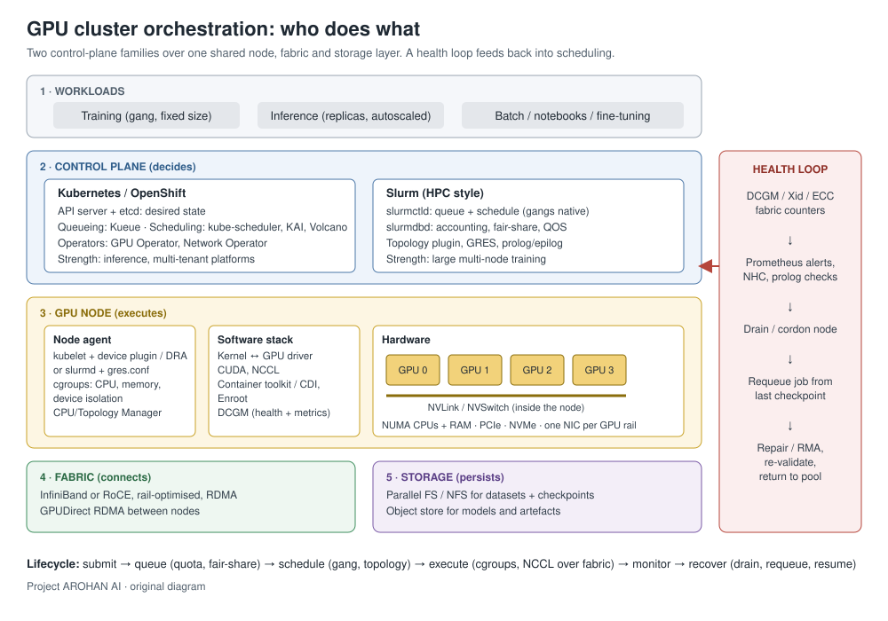

# GPU Cluster Orchestration — the Big Picture

> **Project AROHAN AI · Engineering notes · AI infrastructure track**
> A one-page map of how GPU clusters turn many GPUs, servers and jobs into one system: who decides, who executes, what connects and persists, and how failures are handled. Detail lives in the linked notes and labs; this page connects them.

> **The one-line answer:** GPUs compute, the fabric connects them, storage persists their work, and orchestration decides placement — but in production the **health loop** (detect → drain → requeue → repair) matters as much as the scheduler.

---

## 1. The five layers

| Layer | Job | Kubernetes / OpenShift | Slurm |
|---|---|---|---|
| Workloads | What runs | Deployments (inference), Jobs / JobSets / PyTorchJobs (training) | `sbatch` / `srun` jobs and arrays |
| Control plane | Decide what runs where and when | API server + etcd, kube-scheduler or KAI/Volcano, Kueue for queueing and quota | `slurmctld` (queue + schedule), `slurmdbd` (accounting, fair-share, QOS) |
| GPU node | Execute and isolate | kubelet, device plugin or DRA, CPU/Memory/Topology Manager, container runtime + CDI | `slurmd`, GRES (`gres.conf`), cgroups, prolog/epilog, Enroot/Pyxis |
| Fabric | Move data between GPUs | Network Operator, SR-IOV / RDMA device plugins | Topology plugin (switch-aware placement) |
| Storage | Persist data and checkpoints | CSI volumes (NFS, parallel FS, Ceph) | Shared filesystem mounted on all nodes |

**Rule of thumb in industry:** Slurm still dominates large multi-node *training*; Kubernetes dominates *inference* and multi-tenant platforms. Many AI clusters run both, or Slurm on top of Kubernetes.

---

## 2. The job lifecycle, with what can go wrong

| Stage | What happens | Typical failure | Where to practise |
|---|---|---|---|
| Submit | User or pipeline sends a job with GPU, CPU, memory requests | Wrong requests, missing quota | [Lab 05 Ex 3](../../labs/05-gpu-cluster-operations/README.md), [Ex 9](../../labs/05-gpu-cluster-operations/README.md) |
| Queue | Admission against quota, priority, fair-share | Job starves; one team hogs GPUs | Lab 05 Ex 9 (Kueue), Ex 3 (Slurm QOS) |
| Schedule | Pick nodes: fit, gang, topology | Partial placement deadlock, fragmentation | [Lab 03](../../labs/03-gpu-scheduling/README.md), Lab 05 Ex 11 |
| Execute | Containers/processes start, NCCL connects over the fabric | Driver/CUDA mismatch, device not visible, NCCL hang | [Lab 04 Ex 2, 5, 6](../../labs/04-gpu-infra-hands-on/README.md), Lab 05 Ex 6 |
| Monitor | DCGM metrics, job and fabric telemetry, alerts | Silent throttling, idle allocated GPUs | Lab 04 Ex 4, Lab 05 Ex 8 |
| Recover | Drain bad node, requeue job, resume from checkpoint | Lost days of training without checkpoints | Lab 05 Ex 4, Ex 10 |

---

## 3. What orchestration manages

- **Resource allocation:** whole GPUs, or shares of them (time-slicing, MIG, MPS), plus aligned CPU and memory. Theory: [Kubernetes scheduling deep dive §4](KUBERNETES_SCHEDULING_DEEP_DIVE.md).
- **Topology-aware placement:** keep communicating ranks inside one NVLink domain and under the same leaf switches; align GPU, CPU, memory and NIC on one NUMA node.
- **Gang scheduling:** all ranks of a training job start together or not at all. The default kube-scheduler doesn't do this; KAI, Volcano or Slurm do. Theory: [deep dive §7–8](KUBERNETES_SCHEDULING_DEEP_DIVE.md).
- **Scaling:** replicas for inference (autoscaling on queue depth or latency); training jobs are usually fixed-size gangs, with limited elasticity.
- **Health and recovery:** detect (DCGM, Xid, ECC, fabric counters, node health checks) → drain/cordon → requeue from checkpoint → repair or RMA → re-validate → return to pool.

---

## 4. Corrections and nuances to the common "orchestration" diagram

Popular one-page diagrams of this topic are a good start, but they tend to blur a few things interviewers probe:

1. **The GPU Operator and device plugin are not the control plane.** The operator is a controller that *deploys node-side components* (driver, toolkit, device plugin, DCGM exporter, validators). The device plugin runs **on each node** and advertises GPUs to the kubelet. Dynamic Resource Allocation (DRA) is the newer Kubernetes API for richer device requests.
2. **"Kubernetes schedules GPU jobs" hides the hard part.** Out of the box it schedules pod by pod, which deadlocks distributed training. Queueing (Kueue) and gang/topology-aware schedulers (KAI, Volcano) — or Slurm — are what make it work for training.
3. **"Scaling" means different things.** Inference scales replicas; training scales by asking for a bigger gang next time.
4. **Automatic restart on hardware errors isn't automatic.** It needs health detection wired into the scheduler (prolog checks, NHC, DCGM-based remediation) *and* application checkpoints on shared storage. Without checkpoints, a restart means starting over.
5. **The diagram is missing the operations layer:** node provisioning and burn-in, driver/firmware lifecycle, version consistency (driver ↔ CUDA ↔ NCCL), observability, and multi-tenancy policy. That's where most day-to-day AI-infrastructure work happens.

---

## 5. Interview drill (30 seconds each)

1. **Walk me through what happens from job submission to a running 16-GPU training job.** Submit → queue/quota → gang + topology placement → node agents start containers with GPUs → NCCL forms over the fabric → monitoring → recovery.
2. **Slurm or Kubernetes for a new AI cluster?** Training-heavy research: Slurm (or Slurm on Kubernetes). Inference and multi-tenant products: Kubernetes/OpenShift. Often both.
3. **How does a GPU become schedulable in Kubernetes?** Driver + toolkit on the node, device plugin (or DRA driver) advertises `nvidia.com/gpu`, scheduler counts it as an extended resource.
4. **A node throws Xid 79 mid-run. What should happen automatically?** Alert, drain/cordon, requeue the job from its last checkpoint elsewhere, open a repair ticket, re-validate before return.
5. **Why does topology matter?** All-reduce bandwidth: NVLink inside a node ≫ PCIe ≫ network; poor placement turns a fast cluster into a slow one.

---

## Related in AROHAN

[Kubernetes scheduling deep dive](KUBERNETES_SCHEDULING_DEEP_DIVE.md) · [Workload management mastery](../workload-management/README.md) · [HPC & AI infrastructure mastery](../hpc-ai-infrastructure/README.md) · [AI inference on Kubernetes](../ai-inference/INFERENCE_ON_KUBERNETES.md) · [Lab 04](../../labs/04-gpu-infra-hands-on/README.md) · [Lab 05](../../labs/05-gpu-cluster-operations/README.md)
