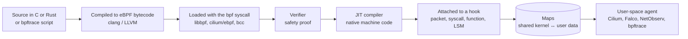

# eBPF for Platform Engineers — Infrastructure-Level Theory

> **Project AROHAN AI · Engineering notes · Platform track**
> How eBPF works inside the Linux kernel, and how Kubernetes and OpenShift use it for networking, observability and runtime security around AI workloads. Theory companion to [Lab 06](../../labs/06-ebpf-platform-observability-security/README.md). Tracing tools (bcc, bpftrace) are covered in [Linux internals 04](../linux-internals/04-tracing-and-debugging.md) and not repeated here.

> **The one-line answer:** eBPF lets verified, sandboxed programs run at hook points inside the kernel and share data with user space through maps — so networking, visibility and security can be added to every node without kernel modules, sidecars or application changes.

---

## 1. Why eBPF exists

Before eBPF there were two ways to change kernel behaviour:

| Option | Problem |
|---|---|
| Change the kernel source | Years until it reaches production distributions |
| Load a kernel module | Full kernel privilege, no safety checks; a bug panics the node, and modules break on kernel updates (the same coupling as GPU drivers) |

eBPF adds a third way: small programs that the kernel **verifies before running**, so they cannot crash or hang the kernel, attached to well-defined hooks, and loadable or removable at runtime. Classic BPF (1992) filtered packets for `tcpdump`; extended BPF (Linux 3.18 onward) grew into a general in-kernel execution engine.

---

## 2. How an eBPF program runs

1. **Compile:** programs are written in restricted C (or Rust, or bpftrace's language) and compiled to eBPF bytecode — a small 64-bit instruction set with 11 registers and a 512-byte stack.
2. **Load:** a loader (libbpf, the Go `cilium/ebpf` library, bcc) calls the `bpf()` syscall with the bytecode and its program type.
3. **Verify:** the verifier walks every possible path and rejects the program unless it can prove: memory accesses are in bounds, pointers are checked before use, loops are bounded and the program terminates, only allowed helper functions are called for that program type. This is what makes eBPF safe to run in production — and why some valid-looking programs are rejected.
4. **JIT:** the verified bytecode is compiled to native instructions, so it runs at near-native speed.
5. **Attach:** the program is attached to a hook (§3). It runs every time that event happens — on every packet, syscall or function call it is attached to.
6. **Maps:** programs store state and pass data to user space through maps (§4). The user-space agent reads them, enriches the data (e.g. with Kubernetes pod names) and exports it.

Programs and maps can be **pinned** in the BPF filesystem (`/sys/fs/bpf`) so they survive the agent restarting — this is how Cilium keeps networking working during an agent upgrade.

---

## 3. Hooks and program types

| Hook / program type | Where it runs | Used for | Used by |
|---|---|---|---|
| **XDP** | In the NIC driver, before the kernel allocates a packet buffer | Fastest packet drop/redirect: DDoS filtering, load balancing | Cilium (optional), Katran-style load balancers |
| **tc / tcx** (traffic control) | Ingress/egress of a network device, on the kernel's packet structure | Pod networking, NAT, policy, flow capture | Cilium datapath, OpenShift Network Observability agent |
| **cgroup socket hooks** (`connect`, `sendmsg`, `sock_ops`) | When a process in a cgroup opens or uses a socket | Socket-level service load balancing, per-pod policy | Cilium (kube-proxy replacement) |
| **kprobe / kretprobe** | Entry/return of almost any kernel function | Deep tracing; not a stable interface | bcc tools, Tetragon |
| **tracepoints / raw tracepoints** | Stable, predefined kernel events (e.g. syscall entry/exit, scheduler switches) | Reliable tracing across kernel versions | Falco, bpftrace, Tetragon |
| **uprobe / USDT** | Functions in user-space binaries and libraries | Tracing applications (e.g. TLS libraries before encryption) | bpftrace, Pixie-style tools |
| **perf events** | CPU sampling, hardware counters | Profiling, flame graphs | profilers |
| **LSM (BPF LSM)** | Linux Security Module hooks (file open, exec, socket connect …) | **Enforcement**: allow or deny actions in-kernel | Tetragon, KubeArmor-style tools |

Rule of thumb: **networking uses XDP/tc/cgroup hooks; observability uses tracepoints/kprobes/uprobes; enforcement uses LSM hooks** (or signals).

---

## 4. Maps: the data plane between kernel and user space

| Map type | Holds | Example use |
|---|---|---|
| Hash / LRU hash | Key → value, LRU evicts old entries | Connection tracking, service → backend tables |
| Array / per-CPU array | Fixed-size indexed values | Counters without lock contention |
| LPM trie | Longest-prefix-match keys | IP/CIDR policy lookups |
| Ring buffer / perf event array | Stream of events to user space | Security events (Falco), flow records |
| Program array | Other eBPF programs | **Tail calls**: chaining programs to stay within verifier limits |

Maps are why eBPF scales: a service with 5,000 backends is a **hash lookup**, not 5,000 iptables rules walked in order.

---

## 5. BTF and CO-RE: why kernel versions matter

Kernel structures change between versions, so a program reading a struct field compiled on one kernel may read garbage on another.

- **BTF** (BPF Type Format) is compact type information about the running kernel, exposed at `/sys/kernel/btf/vmlinux`.
- **CO-RE** (Compile Once – Run Everywhere): libbpf uses BTF at load time to fix up field offsets for the running kernel. One binary then runs across many kernel versions — the reason modern agents (Cilium, Falco's modern probe, the Network Observability agent) ship as plain binaries without compiling on each node.

Operational consequences:

- Feature availability depends on kernel version and configuration (ring buffers, BPF LSM, `tcx` hooks all arrived in specific kernel releases).
- Enterprise kernels (RHEL/RHCOS) backport eBPF features, so the version number alone doesn't tell you what's supported — check the vendor's support statement.
- Kernel upgrades must be validated with the eBPF agents, the same discipline as GPU drivers ([Lab 04 Ex 5](../../labs/04-gpu-infra-hands-on/README.md)).

---

## 6. Networking: kube-proxy, Cilium and OVN-Kubernetes

| | kube-proxy (iptables mode) | Cilium (eBPF datapath) | OVN-Kubernetes (OpenShift default) |
|---|---|---|---|
| Service load balancing | iptables NAT rules per packet; chains grow with services | eBPF maps; with socket-level LB the backend is chosen once at `connect()`, so no per-packet NAT for in-cluster traffic | OVN load balancers programmed into Open vSwitch flows |
| Scale behaviour | Rule updates and lookups slow down with thousands of services | Constant-time map lookups | Flow-based, scales with OVS |
| Network policy | iptables rules by IP | **Identity-based**: pods get numeric security identities from labels; policies match identities, not IPs | OVN ACLs; NetworkPolicy, AdminNetworkPolicy |
| L7 policy (HTTP, gRPC) | No | Yes, by redirecting traffic to an embedded Envoy proxy (L7 is not pure eBPF) | No (use a service mesh) |
| Visibility | conntrack, logs | Hubble flows from eBPF events | Network Observability Operator (eBPF agent) |

Newer kube-proxy versions also offer IPVS and nftables modes, which scale better than plain iptables but are still not eBPF.

---

## 7. Observability: from packets to flows

**Hubble (Cilium):** the Cilium agent's eBPF programs emit events (forwarded, dropped, policy verdict, L7 request) into a ring buffer; the agent enriches them with pod and identity metadata; Hubble Relay aggregates all nodes; the CLI and UI query them. Because Cilium enforces policy, Hubble can say **which policy dropped a packet**.

**OpenShift Network Observability Operator:** an eBPF agent DaemonSet attaches to the ingress and egress of network interfaces and aggregates packets into flows in kernel maps; a processor enriches them with Kubernetes metadata and stores them in Loki and/or exports Prometheus metrics; the OpenShift console plug-in shows topology and flow tables ([OpenShift docs](https://docs.redhat.com/en/documentation/openshift_container_platform/latest/html/network_observability/network-observability-overview)). Optional features add packet drops (with kernel drop reasons), DNS latency, round-trip time and OVN network-policy events.

**Sampling matters:** flow capture costs CPU and storage. Production clusters often sample (e.g. 1 in 50 packets) for traffic analysis and capture everything only for drops and policy events.

---

## 8. Runtime security: detect vs enforce

| Tool | Mechanism | Detects | Enforces |
|---|---|---|---|
| **Falco** | eBPF probe on syscall tracepoints streams events to a user-space rules engine | Shells in containers, sensitive file access, unexpected network connections, privilege changes | No — alerts only (response is automated outside Falco) |
| **Tetragon** | kprobes, tracepoints and LSM hooks with **in-kernel filtering** | Process execution, file and network activity, with full process ancestry | Yes, in-kernel: kill the process or override the call's return value |
| **Red Hat Advanced Cluster Security** | eBPF-based collector on each node feeds central policy evaluation | Runtime process and network behaviour, plus image vulnerabilities and misconfiguration | Through Kubernetes: admission control (block deploys) and scaling/killing violating pods — not in-kernel |
| **Security Profiles Operator** (OpenShift) | eBPF recorder captures the syscalls a workload uses | — | Generates seccomp/SELinux profiles that the kernel then enforces |

Key distinction for interviews: **detection in user space** (Falco) has a gap between the event and the response; **in-kernel enforcement** (Tetragon, BPF LSM) stops the action synchronously; **platform enforcement** (RHACS) acts at deploy time and through the Kubernetes API.

---

## 9. Limits, costs and risks

- **eBPF cannot see inside the GPU.** It sees the host: syscalls, scheduling, memory, block I/O, network. GPU utilisation, memory, throttling and Xid errors come from DCGM/NVML ([NCA-AIIO map](../NVIDIA/NCA-AIIO-ECOSYSTEM-MAP.md)). Uprobes on CUDA libraries are possible but costly and fragile. Debug AI workloads by correlating both ([Lab 06 Ex 7](../../labs/06-ebpf-platform-observability-security/README.md)).
- **Encrypted traffic:** packet hooks see ciphertext; reading plaintext needs uprobes on TLS libraries.
- **Overhead:** cheap per event, but hooks on hot paths (every packet, every syscall) add up. Measure with `kernel.bpf_stats_enabled` and agent CPU.
- **Privilege:** loading eBPF requires `CAP_BPF` plus `CAP_NET_ADMIN` or `CAP_PERFMON` (or root). eBPF agents run as privileged DaemonSets; unprivileged eBPF is disabled by default on enterprise kernels. A compromised agent is a node compromise.
- **Kernel coupling:** feature support and verifier behaviour vary by kernel; agent upgrades and kernel upgrades must be tested together.
- **Verifier limits:** complex programs hit instruction and complexity limits and must be split (tail calls).
- **Secure Boot / lockdown** can restrict some eBPF features; check before rolling out an agent.

---

## 10. Where eBPF shows up on an AI platform

| Layer | eBPF role |
|---|---|
| Pod networking for inference services | Cilium datapath, or OVN-Kubernetes + eBPF flow capture |
| Multi-tenant isolation | Identity-based network policy; flow evidence for audits |
| Inference latency debugging | Run-queue delay, retransmits and slow syscalls on the serving node, correlated with DCGM |
| Training job slowness | Drops or retransmits on the NCCL TCP path; CPU starvation of data loaders |
| Runtime security for model-serving pods | Detect shells, unexpected egress (data exfiltration), crypto miners on GPU nodes |
| Cost and capacity | Which workloads talk to what, and how much traffic crosses zones |

---

## 11. Interview drill (30 seconds each)

1. **What is eBPF, and why is it safer than a kernel module?** Verified, sandboxed programs at kernel hooks; the verifier proves memory safety and termination before JIT; a module has no such checks.
2. **What do maps do?** Store state and share data between eBPF programs and user space — conntrack tables, service backends, event streams.
3. **What are BTF and CO-RE?** Kernel type information plus load-time relocation, so one compiled agent runs across kernel versions.
4. **How does Cilium replace kube-proxy?** Services as eBPF maps; socket-level load balancing picks the backend at `connect()`; constant-time lookups instead of iptables chains.
5. **What does OpenShift use instead of Cilium and Hubble?** OVN-Kubernetes for networking; the Network Observability Operator's eBPF agent for flows.
6. **Falco vs Tetragon vs RHACS?** Detect in user space vs enforce in-kernel vs policy and enforcement through Kubernetes plus image risk.
7. **Can eBPF monitor GPUs?** Not their internals — use DCGM/NVML; eBPF covers the host side, and you correlate the two.

---

## Related in AROHAN

[Lab 06](../../labs/06-ebpf-platform-observability-security/README.md) · [Linux internals 04: tracing tools](../linux-internals/04-tracing-and-debugging.md) · [Linux internals 07: networking and firewall](../linux-internals/07-networking-and-firewall.md) · [Kernel troubleshooting roadmap, Phases 7–8](../kernel-troubleshooting/ROADMAP.md) · [OpenShift vs Kubernetes](OPENSHIFT_VS_KUBERNETES.md)

## Sources

- [ebpf.io: What is eBPF?](https://ebpf.io/what-is-ebpf/)
- [Linux kernel documentation: BPF](https://docs.kernel.org/bpf/index.html)
- [Cilium documentation](https://docs.cilium.io)
- [OpenShift: About network observability](https://docs.redhat.com/en/documentation/openshift_container_platform/latest/html/network_observability/network-observability-overview)
- [Red Hat: eBPF in OpenShift network observability](https://www.redhat.com/en/blog/ebpf-openshift-network-observability)
- [Falco documentation](https://falco.org/docs/) · [Tetragon documentation](https://tetragon.io/docs/)
- Liz Rice, *Learning eBPF* (O'Reilly)
