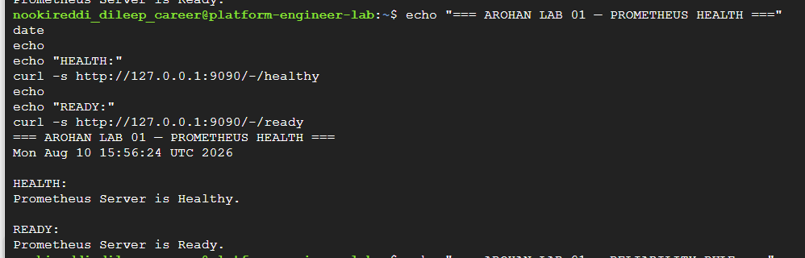
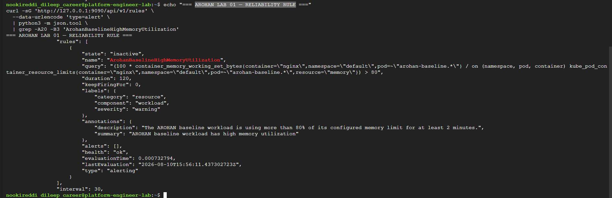
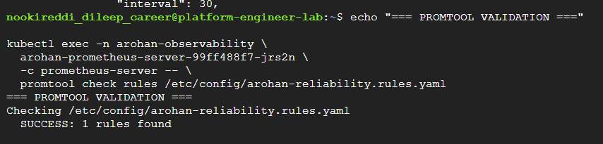

# AROHAN Lab 01 — Workload Reliability Foundation

## Status

**LAB 01 — COMPLETE ✅** · validated 2026-08-10 · [full validation record](evidence/AROHAN-Lab-01-VALIDATION.md)

| Capability | Status |
|---|---|
| Kubernetes workload baseline | ✅ |
| Prometheus observability (Helm) + kube-state-metrics | ✅ |
| Container CPU / memory telemetry | ✅ |
| Resource-limit correlation in PromQL | ✅ |
| Reliability SLI + sustained-condition alert | ✅ |
| Controlled failure injection | ✅ |
| Alert lifecycle (inactive → pending → firing → inactive) | ✅ |
| Recovery validation | ✅ |
| promtool rule validation | ✅ |
| Evidence captured | ✅ |

---

## Objective

Build and prove the first AROHAN reliability control loop:

**Observe → Measure → Detect → Alert → Inject failure → Validate → Recover**

The lab uses a baseline NGINX workload to establish the pattern before applying it to GPU and AI workloads ([Lab 02](../02-ai-inference-reliability/README.md) applies it to LLM inference).

## Engineering problem

A container having a memory limit does not tell you whether it is operating safely. The lab answers:

- How much memory is the workload actually using, and what is its limit?
- Is utilization approaching the limit, and is that transient or sustained?
- Can the platform detect it automatically, against live telemetry?
- Does the alert clear when the condition goes away?

## Environment

| Component | Value |
|---|---|
| Cloud / Kubernetes | GCP VM, K3s, single node (4 vCPU, ~15 GiB) |
| Workload | `arohan-baseline` (nginx:1.27-alpine) in namespace `default` |
| Memory request / limit | 64Mi / 128Mi |
| Observability namespace | `arohan-observability` |
| Prometheus | Helm chart `prometheus-community/prometheus` 29.23.0, Prometheus 3.13.2 |
| Storage / retention | 10Gi PVC on `local-path`, 7 days |
| kube-state-metrics | Enabled (Alertmanager, node-exporter, pushgateway disabled for this lab) |

## Architecture

```text
arohan-baseline (NGINX on K3s)
        │ container telemetry
        ▼
cAdvisor / kubelet ──► Prometheus ◄── kube-state-metrics (declared limits)
                          │
                          ▼
        Memory utilization SLI = working set / limit × 100
                          │
                          ▼
        > 80% for 2 min → ArohanBaselineHighMemoryUtilization
                          │
                          ▼
        INACTIVE → PENDING → FIRING → (condition removed) → INACTIVE
```

## Repository structure

```text
labs/01-workload-reliability/
├── README.md
├── kubernetes/
│   ├── baseline-workload.yaml        Deployment with requests, limits, probes
│   └── baseline-service.yaml         ClusterIP service
├── observability/
│   ├── README.md
│   ├── prometheus-values.yaml        Helm values
│   └── arohan-reliability.rules.yaml alert rule
└── evidence/
    ├── 01-prometheus-health.png
    ├── 02-reliability-rule.png
    ├── 03-promtool-validation.png
    └── AROHAN-Lab-01-VALIDATION.md
```

## Observability foundation

Prometheus was installed with Helm using [`observability/prometheus-values.yaml`](observability/prometheus-values.yaml): persistent volume (10Gi, `local-path`), 7-day retention, server requests 100m / 256Mi and limits 500m / 512Mi, and kube-state-metrics enabled.

## Metrics validation

CPU:

```promql
rate(container_cpu_usage_seconds_total{container="nginx", pod=~"arohan-baseline.*"}[5m])
```

Memory working set:

```promql
container_memory_working_set_bytes{container="nginx", pod=~"arohan-baseline.*"}
```

Declared memory limit (kube-state-metrics), confirmed as `134217728` bytes = 128Mi:

```promql
kube_pod_container_resource_limits{namespace="default", container="nginx", pod=~"arohan-baseline.*", resource="memory"}
```

## Troubleshooting finding

The resource-limit metric was missing at first. The cause: kube-state-metrics was disabled in the Helm values. After enabling it and running `helm upgrade`, the metric appeared.

**Lesson:** a useful reliability signal often needs runtime telemetry (cAdvisor) **joined with** Kubernetes metadata and declared configuration (kube-state-metrics). This was a real dependency found and fixed during the lab.

## Reliability SLI and alert

Memory utilization % = working set ÷ memory limit × 100. The alert ([rule file](observability/arohan-reliability.rules.yaml)):

```promql
(
  100 * container_memory_working_set_bytes{namespace="default", container="nginx", pod=~"arohan-baseline.*"}
  / on(namespace, pod, container)
  kube_pod_container_resource_limits{namespace="default", container="nginx", pod=~"arohan-baseline.*", resource="memory"}
) > 80
```

- `on(namespace, pod, container)` joins the runtime metric to the declared limit for the same container.
- `for: 2m` stops a short spike from becoming an alert.
- Labels: `severity: warning`, `component: workload`, `category: resource`.

The rule file was mounted at `/etc/config/arohan-reliability.rules.yaml` and added to Prometheus `rule_files`; the live rule was confirmed through the Prometheus rules API.

## Rule validation

```bash
kubectl exec -n arohan-observability arohan-prometheus-server-99ff488f7-jrs2n -c prometheus-server -- \
  promtool check rules /etc/config/arohan-reliability.rules.yaml
# Checking /etc/config/arohan-reliability.rules.yaml
#   SUCCESS: 1 rules found
```

## Controlled failure injection

A temporary pod, `arohan-baseline-memory-test` (limit 128Mi), was configured to allocate about 110Mi. Prometheus observed `115896320` of `134217728` bytes:

115896320 ÷ 134217728 × 100 ≈ **86.35%**, above the 80% threshold.

## Alert lifecycle and recovery

```text
INACTIVE ──(memory pressure injected)──► PENDING ──(>80% for 2 min)──► FIRING (86.35%)
FIRING ──(kubectl delete pod arohan-baseline-memory-test)──► INACTIVE (alerts: [], health: ok)
```

Both detection and recovery detection were validated against live telemetry.

## Evidence

| Evidence | Shows |
|---|---|
|  | Prometheus server healthy and ready |
|  | Live rule `ArohanBaselineHighMemoryUtilization`: state inactive, health ok, interval 30s |
|  | `SUCCESS: 1 rules found` |

The [validation record](evidence/AROHAN-Lab-01-VALIDATION.md) has the full implementation, failure-injection and recovery record.

**Honesty note:** the original failure-injection terminal session was lost after a GCP SSH disconnect. The PENDING / FIRING / recovery results in the validation record come from Prometheus API output captured during that experiment; there is no screenshot of the firing state.

## Known gaps (next iteration)

- The workload runs in `default`; a dedicated namespace with a ResourceQuota would match the [engineering principles](../../standards/ENGINEERING_PRINCIPLES.md). Lab 02 already does this.
- The memory-test pod manifest was not committed, so the failure injection can't be replayed from the repo yet.
- The rule could be hardened with `max by (namespace, pod, container)` and `container!=""` to guard against duplicate cAdvisor series.

These are deliberately **not** changed here: the manifests and rule in this folder are exactly what was validated.

## What was proven

| Step | Result |
|---|---|
| Observe | Container CPU and memory telemetry collected |
| Correlate | Runtime metrics joined with declared Kubernetes limits |
| Measure | Utilization calculated against the limit |
| Detect | Sustained pressure identified (`for: 2m`) |
| Alert | INACTIVE → PENDING → FIRING |
| Recover | FIRING → INACTIVE after the condition was removed |

## Summary

Built and validated a Kubernetes workload-reliability control loop with Prometheus and kube-state-metrics: correlated live container memory with declared limits in PromQL, alerted on sustained pressure, proved it with controlled failure injection (≈86% of limit), and verified recovery.
